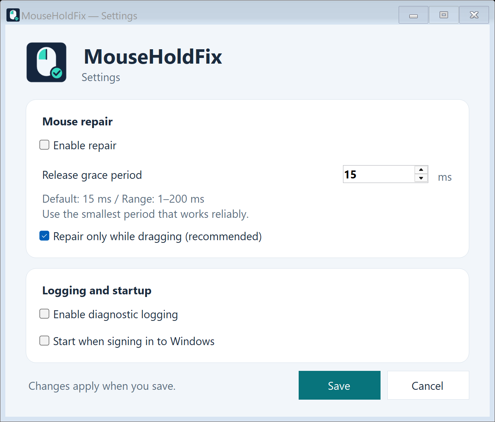
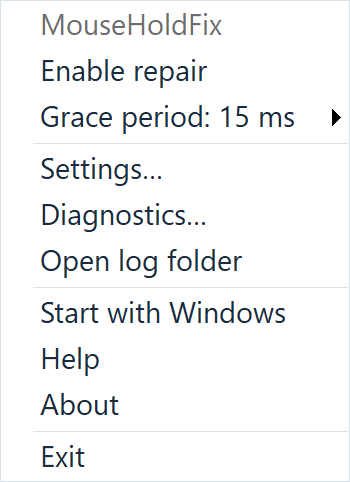
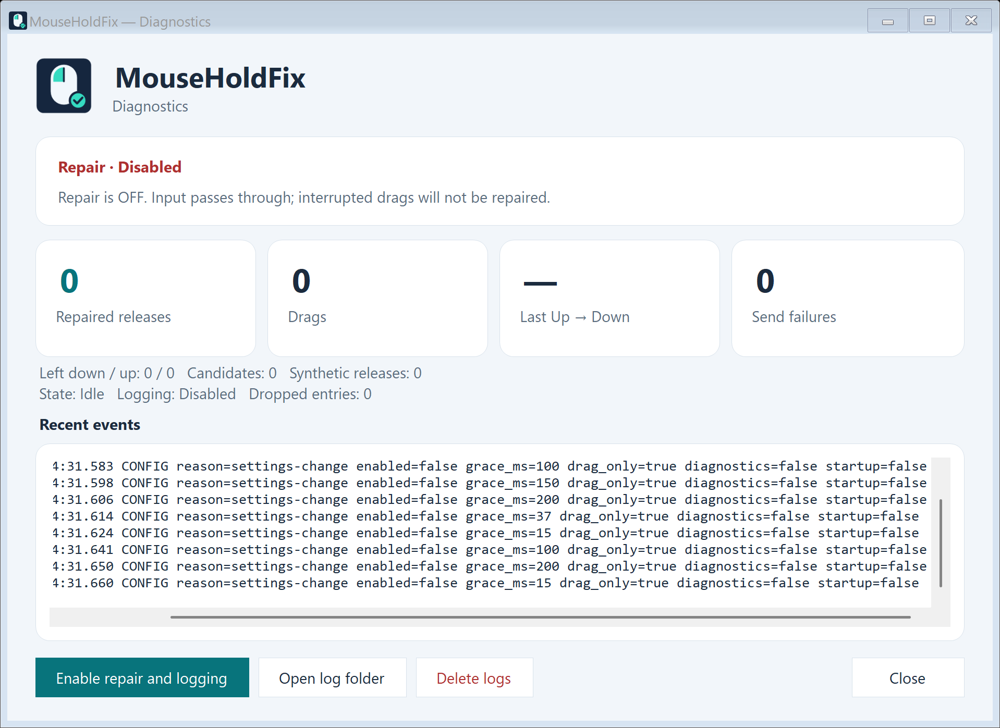

# MouseHoldFix

**左ボタンを押し続けているのに、ドラッグが途中で途切れる症状を補正します。**

最新リリース：**1.0.0**（2026-10-04）

Windows 用タスクトレイ常駐ソフト · 作者 **HizTam** · [MIT ライセンス](LICENSE.txt)

[English instructions](README.md)

## 改善する症状の例

- `Win + Shift + S` で画面キャプチャ範囲を選択している途中で、勝手に範囲選択が確定する
- Webブラウザやエディタで文字列をドラッグ選択している途中で選択が終了する
- その直後、すでに選択済みの文字列をドラッグして移動する状態になる
- ファイルのドラッグ＆ドロップが途中で解除される
- 通常のクリック確認サイトではチャタリングが確認できない場合がある

これらは代表的な例です。このほかにも、押し続けている左ボタンが一瞬だけ解除され、再び押されたと報告されることが原因の症状を補正します。解除を短時間待ち、その間に再押下があればドラッグを継続します。

## 起動する

対応環境は **Windows 10 / 11、x64**。下の準備ファイルは「管理者として実行」してください。MouseHoldFix 本体は通常、管理者権限や専用インストーラーなしで実行できます。

次のどちらかの ZIP を選びます。

| ZIP のファイル名末尾 | ランタイムの準備 |
| --- | --- |
| `win-x64-self-contained.zip` | .NET 同梱版。そのまま下の展開・起動手順へ進みます。 |
| `win-x64-framework-dependent.zip` | .NET 非同梱版。先に **.NET 10 デスクトップ ランタイム（Windows x64）** をインストールします。 |

### .NET 非同梱版のランタイムをインストールする

1. [Microsoft 公式の .NET 10 ダウンロードページ](https://dotnet.microsoft.com/ja-jp/download/dotnet/10.0) を開きます。
2. 最新の **10.0.x** の「**.NET デスクトップ ランタイム**」で、「**Windows → インストーラー → x64**」を選びます。
3. ダウンロードしたインストーラーを実行し、インストールを完了します。すでにこのランタイムが入っている場合は、下の起動手順へ進みます。

デスクトップ ランタイムには通常の .NET ランタイムも含まれます。MouseHoldFix の実行に必要なのはデスクトップ ランタイムです。

### 重要：EXE を実行する前に行ってください

**以下の準備は、`MouseHoldFix.exe` を初めて実行する前に行ってください。**

Windows 11 の **スマート アプリ コントロール**などによる、初回起動時のブロックに対処するための手順です。本アプリでは、初回起動前の `Unblock-File` で起動できた環境があります。Windows の保護設定によっては、解除後もスマート アプリ コントロールでブロックされる場合があります。[Microsoft の公式説明](https://support.microsoft.com/en-us/windows/security/threat-malware-protection/smart-app-control-frequently-asked-questions)。

1. エクスプローラーで ZIP を右クリックし、「**すべて展開…**」でフォルダーに展開します。展開されたファイルとフォルダーはすべて一緒に置いてください。
2. 展開先で **`Prepare-MouseHoldFix.cmd`** を右クリックし、「**管理者として実行**」を選びます。Windows の確認画面で許可します。
3. 「**解除処理が完了しました**」と表示されたら、何かキーを押してウィンドウを閉じます。エラーが表示された場合は、EXE を起動する前に内容を確認してください。

準備が完了したら、下の「MouseHoldFix を起動する」に進んでください。新しくダウンロードした場合も、**EXE の初回実行前に**この準備を行ってください。

準備ファイル自体が Windows にブロックされる場合は、ダウンロードした ZIP の「**プロパティ**」で「**許可する**」が表示されていれば適用し、ZIP を改めて展開してから上の手順を行ってください。

### MouseHoldFix を起動する

1. 展開先のフォルダーから `MouseHoldFix.exe` を通常どおり実行します。
2. タスクトレイのマウスアイコンを探します。「隠れているインジケーター」も確認してください。
3. アイコンをダブルクリックして設定を開き、「補正を有効にする」「ドラッグ中だけ補正する」を ON にします。
4. 初期値の **15 ms** から始め、「保存」を押し、問題の操作を試します。

Windows の表示言語が日本語なら日本語、それ以外は英語で表示します。以下の画像はすべて **英語 UI** です。

## 設定

| 項目 | 使い方 |
| --- | --- |
| 補正を有効にする（Enable repair） | 補正を ON / OFF にします。初期値は ON。 |
| 解除を待つ時間（Release grace period） | 解除を確定するまで待つ時間。**1〜200 ms**、初期値は **15 ms**。 |
| ドラッグ中だけ補正する（Repair only while dragging） | 普段は ON を推奨。通常クリックやダブルクリックに待機を加えません。初期値は ON。 |
| 診断ログを記録する（Enable diagnostic logging） | 症状を調べるときに、マウス操作をローカルに記録します。初期値は OFF。 |
| Windows のログオン時に起動する（Start when signing in to Windows） | サインイン時に自動起動します。初期値は OFF。 |

「保存」で変更を適用します。「キャンセル」または **Esc** で未保存の変更を破棄します。

まだドラッグが途切れる場合は待機時間を少しずつ増やし、症状が収まるできるだけ小さな値を使ってください。待機時間を長くすると、本当にボタンを離したときのドラッグ終了も遅れます。「ドラッグ中だけ補正する」を OFF にすると通常クリックにも待機が加わり、素早い連続クリックが結合される場合があります。

## タスクトレイのメニュー

- **補正を有効にする**：補正を即座に ON / OFF にします。
- **待機時間**：**5 / 10 / 15 / 20 / 30 / 50 / 75 / 100 / 125 / 150 / 200 ms** へ切り替えます。選んだ値は即座に適用・保存されます。
- **設定…**：上記の各項目を設定します。
- **診断…**：補正状態、修復回数、直近の入力間隔、ログを確認します。
- **ログフォルダーを開く**：保存したログを開きます。
- **Windows 起動時に実行**：自動起動を切り替えます。
- **ヘルプ**：操作説明を表示します。
- **バージョン情報**：バージョン情報を表示します。
- **終了**：補正を停止してアプリを終了します。

補正が有効なときはアイコンに緑のチェック、無効なときは灰色のマイナスが表示されます。

## ヘルプ

日本語の Windows では日本語、それ以外では英語の説明を開きます。冒頭の言語リンクで、同じ画面内で別の言語へ切り替えられます。

## 症状を調べる

1. 「補正を有効にする」を OFF、「診断ログを記録する」を ON にして保存します。
2. 問題の操作を繰り返します。
3. 「診断…」で **直近 Up → Down（Last Up → Down）** とログを確認します。
4. 意図しない解除・再押下の間隔を覆う待機時間を選び、補正とドラッグ限定を ON に戻して試します。
5. 調査後は診断ログを OFF にします。

診断画面の「補正を有効にして記録」は、現在の待機時間のまま補正とログを ON にします。症状を改善するときは補正が ON になっていることを確認してください。

診断画面の「**ログを削除**」で、ログフォルダー全体をゴミ箱へ移動できます。記録中はこのボタンが無効になります。「診断ログを記録する」を OFF にしてから使ってください。ログフォルダーがない場合は、「ログを削除」と「ログフォルダーを開く」の両方が無効になります。トレイの「ログフォルダーを開く」も同様です。

## 補正対象

補正は、マウスとして認識される全機器共通の左ボタン入力に作用します。右・中ボタンやタッチジェスチャは対象外です。左ボタンを押し続けていても、PC が「離されたまま」と認識する不具合は補正できません。管理者権限のアプリでは補正が制限される場合があります。

## 更新・削除

更新するときは、トレイの「終了」で閉じてから新しい版へ置き換えます。自動起動が ON の場合は、フォルダーの移動・削除前に OFF にし、必要なら移動先のアプリで ON にし直してください。

新しくダウンロードしたファイルは、上の初回起動前の解除手順を行ってから起動してください。

削除するときはアプリを終了してフォルダーを削除します。設定とログも不要なら `%LOCALAPPDATA%\MouseHoldFix` を削除します。

## セキュリティとプライバシー

MouseHoldFix 本体は **外部通信を一切行いません**。更新確認、利用状況の送信、設定やログのアップロードも行いません。キーボード入力は記録しません。

設定とログは、この PC の `%LOCALAPPDATA%\MouseHoldFix` に保存します。診断ログにはマウス位置と日時が含まれます。不要になったログは、診断画面の「ログを削除」でゴミ箱へ移動できます。

ヘルプ内の外部リンクをクリックした場合は、既定のブラウザーでその Web ページを開きます。このときの通信はブラウザーが行います。

## What's New in 1.0.0

最初のリリース。

- Windows 10 / 11 x64 向けの正式版。画面キャプチャ、文字列選択、ファイルのドラッグを途中で終了させる、一瞬の左ボタン解除を補正します。

## Changelog

更新履歴の詳細は [CHANGELOG（英語）](CHANGELOG.md) を参照してください。

ライセンス：[LICENSE.txt](LICENSE.txt) · [第三者ライセンス](THIRD-PARTY-NOTICES.md)

